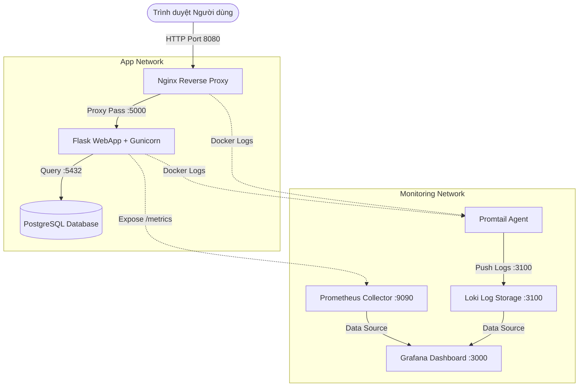

# BÁO CÁO BÀI TẬP LỚN: TRIỂN KHAI VÀ QUẢN TRỊ HỆ THỐNG PHẦN MỀM

- **Họ và tên sinh viên:** Nguyễn Mạnh Cường
- **Mã số sinh viên (MSSV):** DTC245200124
- **Lớp / Khóa:** CNTT K23E
- **Tên đề tài:** Triển khai, giám sát và quản trị hệ thống phần mềm Microservices container hóa dựa trên Docker, Nginx, Prometheus, Grafana và Loki.

---

## 🚀 1. Tổng quan & Kiến trúc hệ thống

Hệ thống được thiết kế theo chuẩn microservices container hóa, phân chia thành 2 phân vùng mạng tách biệt (`app-network` và `monitoring-network`) nhằm nâng cao tính bảo mật và tối ưu luồng giám sát.

### Sơ đồ kiến trúc:


### Bảng phân bổ dịch vụ & Cổng truy cập:

| STT | Dịch vụ (Container) | Cổng Host (Public) | Cổng Nội bộ | Chức năng chính |
| :--- | :--- | :--- | :--- | :--- |
| 1 | **Nginx Proxy** | `8080` | `80` | Cổng vào duy nhất (Reverse Proxy, Security Headers, Gzip) |
| 2 | **WebApp** | - (Cô lập) | `5000` | Ứng dụng Flask + Gunicorn, nghiệp vụ CRUD, Prometheus Exporter |
| 3 | **PostgreSQL DB** | - (Cô lập) | `5432` | Cơ sở dữ liệu quan hệ, lưu trữ dữ liệu an toàn |
| 4 | **Prometheus** | `9090` | `9090` | Giám sát và thu thập Time-series Metrics từ WebApp |
| 5 | **Grafana** | `3000` | `3000` | Trực quan hóa Metrics và tra cứu Logs tập trung |
| 6 | **Loki** | `3100` | `3100` | Gom và lưu trữ log tập trung từ các containers |
| 7 | **Promtail** | - (Internal) | `9080` | Thu thập Docker logs và stream về Loki |

---

## 🛠️ 2. Hướng dẫn cài đặt và vận hành

### Bước 1: Yêu cầu môi trường
- Cài đặt **Docker Desktop** (hoặc Docker Engine & Docker Compose v2+).
- Đảm bảo Docker Daemon đang hoạt động bình thường.

### Bước 2: Khởi chạy toàn bộ hệ thống
Mở terminal tại thư mục gốc của dự án và chạy lệnh:
```bash
docker compose up -d --build
```
> Hệ thống sẽ tự động tải các image cần thiết, build image cho WebApp, khởi tạo database và nạp sẵn cấu hình giám sát cho Grafana.

### Bước 3: Kiểm tra trạng thái các container
```bash
docker compose ps
```
Tất cả 7 containers phải hiển thị trạng thái `running` (Up) hoặc `healthy`.

---

## 🌐 3. Danh mục các đường dẫn kiểm thử hệ thống

- **Trang chủ WebApp (qua Nginx):** [http://localhost:8080](http://localhost:8080)
- **Kiểm tra tình trạng sống (Healthcheck):** [http://localhost:8080/health](http://localhost:8080/health)
- **Kiểm tra kết nối Database:** [http://localhost:8080/db-check](http://localhost:8080/db-check)
- **Prometheus Metrics thô:** [http://localhost:8080/metrics](http://localhost:8080/metrics)
- **Giao diện Prometheus Web:** [http://localhost:9090](http://localhost:9090) (Status -> Targets)
- **Giao diện Cảnh báo Prometheus (Alerts):** [http://localhost:9090/alerts](http://localhost:9090/alerts)
- **Giao diện Grafana Dashboard:** [http://localhost:3000](http://localhost:3000) (Tài khoản: `admin` / `admin`)
- **Kiểm tra Loki Ready:** [http://localhost:3100/ready](http://localhost:3100/ready)

---

## 🔔 3.2. Cấu hình Hệ thống Cảnh Báo (Prometheus Alerting Rules)

File cấu hình cảnh báo `prometheus/alert.rules.yml` được tích hợp tự động vào Prometheus nhằm phát hiện và cảnh báo sớm các bất thường:

```yaml
groups:
  - name: webapp_system_alerts
    rules:
      # 1. Cảnh báo sập dịch vụ WebApp
      - alert: WebAppDown
        expr: up{job="webapp"} == 0
        for: 30s
        labels:
          severity: critical
        annotations:
          summary: "Dịch vụ WebApp không phản hồi (Service DOWN)"
          description: "Container WebApp đã ngừng hoạt động hơn 30 giây."

      # 2. Cảnh báo tỷ lệ lỗi HTTP 5xx tăng bất thường
      - alert: HighHttp5xxRate
        expr: sum(rate(flask_http_request_total{status=~"5.."}[1m])) > 0
        for: 10s
        labels:
          severity: critical
        annotations:
          summary: "Tỷ lệ lỗi HTTP 5xx tăng bất thường (Server Error Alert)"
          description: "Phát hiện request gây lỗi 500/5xx trên WebApp. Cần kiểm tra log Loki ngay!"

      # 3. Cảnh báo quét URL / Tấn công dò đường dẫn (HTTP 404)
      - alert: HighHttp404Rate
        expr: sum(rate(flask_http_request_total{status="404"}[1m])) > 2
        for: 30s
        labels:
          severity: warning
        annotations:
          summary: "Phát hiện dấu hiệu dò quét URL (High 404 rate)"
          description: "Số lượng request lỗi 404 vượt quá ngưỡng 2 req/giây trên WebApp."
```

---

## 🎯 4. Kịch bản Demo phục vụ Báo cáo & Đánh giá

### Kịch bản 1: Kiểm thử tính toàn vẹn dữ liệu (PostgreSQL)
1. Truy cập `http://localhost:8080`.
2. Tại mục **Quản Lý Dữ Liệu Nghiệp Vụ**, nhập tiêu đề, tên người tạo và nội dung rồi bấm **Lưu Dữ Liệu Vào PostgreSQL**.
3. Bản ghi sẽ hiển thị ngay lập tức trong bảng dữ liệu. Bấm nút **Kiểm Tra Lại Kết Nối Database** để thấy số lượng bản ghi tăng lên.

### Kịch bản 2: Giám sát lưu lượng tải (Traffic Monitoring)
1. Mở song song 2 tab trình duyệt:
   - Tab 1: WebApp `http://localhost:8080`
   - Tab 2: Grafana Dashboard `http://localhost:3000` (mở Dashboard *Báo Cáo Hệ Thống Microservices*)
2. Tại Tab 1, bấm nút **"🚀 Tạo 20 Requests (200 OK)"**.
3. Tại Tab 2, quan sát biểu đồ **"Tần Suất Request Theo Mã HTTP Status"** và **"Lưu lượng truy cập (Req/s)"** nhảy vọt biểu diễn theo thời gian thực.

### Kịch bản 3: Giả lập sự cố và điều tra qua Log (Incident Simulation & Logging)
1. Tại WebApp `http://localhost:8080`, bấm nút **"⚠️ Gây Lỗi 500 (Test Alert)"**.
2. Trên Grafana, bảng **"Lỗi 5xx (Server Error)"** sẽ chuyển sang màu đỏ cảnh báo.
3. Cuộn xuống panel **"📜 NHẬT KÝ HỆ THỐNG THỜI GIAN THỰC (LOKI LOGS)"**, thấy xuất hiện dòng log màu đỏ:
   ```
   [ERROR] [webapp] CANH BAO: Mot loi nghiem trong gia lap vua duoc kich hoat tren he thong (HTTP 500 Internal Server Error)!
   ```
   *Minh chứng khả năng phát hiện và truy vết sự cố nhanh chóng.*

### Kịch bản 4: Kiểm thử Hệ thống Cảnh báo Tự động (Alert Evaluation)
1. Mở tab: **[http://localhost:9090/alerts](http://localhost:9090/alerts)** trên Prometheus. Ban đầu các Rule đều ở trạng thái màu xanh **`Inactive`** (Bình thường).
2. Tại WebApp, bấm liên tiếp nút **"⚠️ Gây Lỗi 500 (Test Alert)"**.
3. Tại trang Alerts của Prometheus, Rule **`HighHttp5xxRate`** sẽ chuyển trạng thái sang **`Pending`** rồi **`Firing`** (Màu đỏ cảnh báo), chứng minh cơ chế cảnh báo tự động hoạt động chính xác!

---

## 🔧 5. Các lệnh Quản trị hệ thống thường dùng

- **Xem log thời gian thực của WebApp:**
  ```bash
  docker compose logs -f webapp
  ```
- **Khởi động lại một container cụ thể:**
  ```bash
  docker compose restart webapp
  ```
- **Tắt và dọn dẹp toàn bộ hệ thống:**
  ```bash
  docker compose down
  ```
- **Xóa toàn bộ dữ liệu database để khởi động lại từ đầu (nếu cần):**
  ```bash
  docker compose down -v
  ```